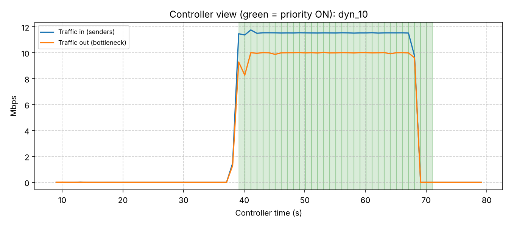
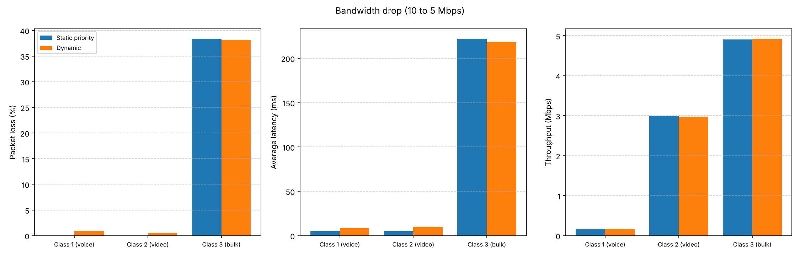
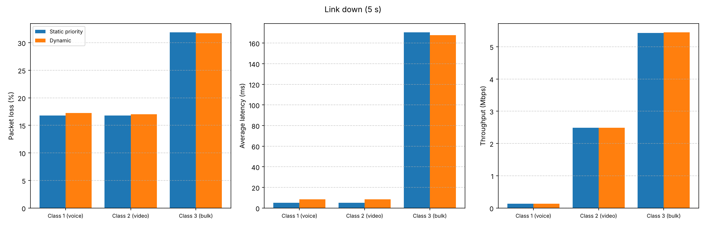
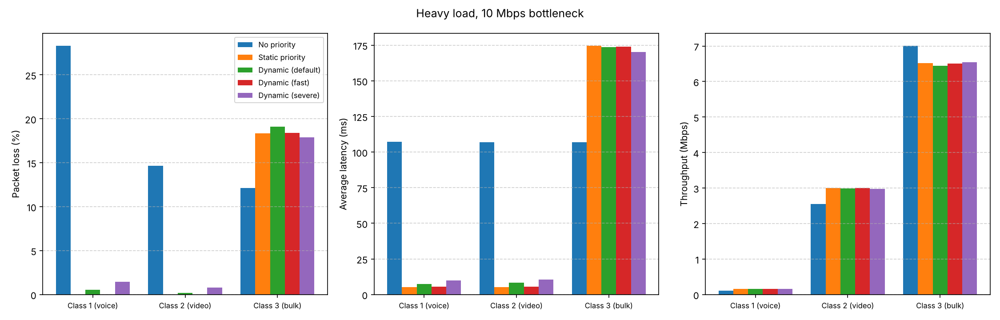
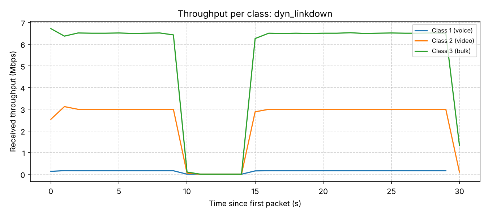

# QoS Traffic Management System: Project Flow Document

**Computer Networks, Jackfruit Problem, Team 11**

| SRN | Name |
|---|---|
| PES2UG25CS150 | Dasari Venu Gurucharan Reddy |
| PES2UG26CS801 | Akshayakumar K M |
| PES2UG25CS171 | Dinnepu Veda Shresta |

**Project title:** QoS Traffic Management System

**Problem statement:** Develop a UDP-based application that generates different classes of traffic and uses SDN to dynamically prioritize selected flows during network congestion.

The system is built on a Mininet network with a single narrow link, three classes of UDP traffic, Open vSwitch priority queues and an **OS-Ken** controller (OpenFlow 1.3) that switches priority on during congestion and off afterwards.

**Protocol:** UDP  **SDN platform:** Mininet + OS-Ken controller (OpenFlow 1.3) with Open vSwitch

> **About the controller.** The project was first built with the Ryu controller and then moved to OS-Ken, the maintained fork of Ryu. The priority logic did not change. Only the package name (`ryu` became `os_ken`), the launcher (`ryu-manager` became `osken-manager`) and the example switch app (OS-Ken does not ship one, so the project has its own learning switch) changed. See "Moving from Ryu to OS-Ken" below.

## Project Expectations

| Expectation | How it is met | Section |
|---|---|---|
| Generate multiple UDP traffic classes | `sender.py`: voice-like, video-like and bulk classes on UDP ports 5001, 5002, 5003 | 2 |
| Classify different application flows | OpenFlow rules match UDP and the destination port; each class goes to its own queue | 3 |
| Implement SDN-based priority policies | Three Open vSwitch queues on the bottleneck port, selected with `set_queue` | 3 |
| Create controlled congestion | 10 Mbps bottleneck (also 8 and 6 Mbps) against about 11.2 Mbps of offered traffic | 1, 9 |
| Measure throughput, latency and packet loss | `receiver.py` measures all three per class, per second and per run | 2, 9 |
| Analyze fairness between traffic classes | Jain's fairness index plus per-class loss and latency (`analysis/analyze.py`) | 9 |
| Dynamically modify traffic policies | The OS-Ken controller switches priority on and off from live link measurements, and optionally from receiver reports | 4, 7 |

## Project Development Flow

1. Problem Understanding and Architecture
2. UDP Socket Implementation and Traffic Measurement
3. Mininet + SDN Implementation
4. Application-SDN Integration
5. Initial Testing and Demo
6. Complete Application Functionality
7. Dynamic SDN Monitoring and Policy Enforcement
8. Challenging Scenarios / Robustness Testing
9. Performance Evaluation and Comparison

## Protocol Responsibilities

| Protocol | Responsibility | Example in this project |
|---|---|---|
| UDP | Lightweight, connectionless communication where low overhead is preferred and where loss must stay visible | The three traffic classes (ports 5001, 5002, 5003); basic socket tools on ports 5000 and 5100 |
| TCP | Reliable, connection-oriented communication | The OpenFlow control channel between the switches and the controller (port 6653). TCP is deliberately not used for the traffic, because it would hide packet loss by resending |
| ICMP (ping) | Check whether a host is reachable and estimate round-trip time | `pingall` to verify connectivity of all four hosts before every run |
| UNIX datagram socket | Local message passing between processes on the same machine | The receiver reports loss and latency to the controller (Section 4) |

**Important:** ping uses ICMP, not TCP or UDP. The traffic being prioritized is UDP, while the controller is reached over TCP (OpenFlow).

## Moving from Ryu to OS-Ken

| Item | Ryu build | OS-Ken build |
|---|---|---|
| Python package | `ryu` | `os_ken` (for example `from os_ken.controller import ofp_event`) |
| Application base class | `RyuApp` | `OSKenApp` |
| Launcher | `ryu-manager` | `osken-manager` |
| Example learning switch | `ryu.app.simple_switch_13` | Not shipped. The project has its own learning switch: `simple_switch_13.py` (for the no-priority and static runs) and the same code inside the controller |
| OpenFlow version, controller port | OpenFlow 1.3, 6653 | Unchanged |
| Mininet side | `RemoteController` on 127.0.0.1:6653 | Unchanged (`topo.py` accepts mode `osken`; `ryu` is kept as an alias) |
| Priority logic and queues | Rules on s1, three queues on s1-eth4 | Unchanged |

The 10 Mbps measurements in Section 9 were taken again with the OS-Ken controller. The 8 and 6 Mbps no-priority and static-priority measurements come from the first measurement round (raw data in `results_ryu_build/`). Those runs do not depend on the controller framework: the no-priority runs use a plain learning switch and the static runs use fixed `ovs-ofctl` rules.

# 1. Problem Understanding and Architecture

**The idea in simple terms.** Think of a road with one narrow bridge. The cars are UDP packets and the bridge is a 10 Mbps link. Class 1 is ambulances (small, urgent), class 2 is buses, class 3 is trucks (large, can wait). Without QoS all three wait in one line and the ambulance is stuck behind the trucks. With SDN QoS, the controller watches the bridge, and when it detects a jam it tells the switch to serve ambulances first, then buses, then trucks. When the jam clears, it removes the rules.

**Architecture.** Four hosts and two switches. Senders h1, h2 and h3 connect to switch s1. s1 connects to s2 over the bottleneck link, and s2 connects to the receiver h4. An OS-Ken controller manages both switches over OpenFlow 1.3, and the receiver can send its measurements back to the controller. Everything runs in one Ubuntu virtual machine.

| Component | Role | Software |
|---|---|---|
| Traffic senders (h1, h2, h3) | One UDP class each | Python 3 sockets |
| Receiver (h4) | Records every packet, computes loss, latency and throughput, optionally reports to the controller | Python 3 sockets, threads |
| Switches (s1, s2) | Forward traffic; s1 holds the priority queues | Open vSwitch |
| Network | Hosts, links, 10 Mbps bottleneck | Mininet |
| Controller | Detects congestion, installs and removes priority rules | OS-Ken, OpenFlow 1.3 |
| Analysis | Tables, fairness, graphs | Python, matplotlib |
| Code sharing | Repository with reproduction steps | Git, GitHub |

**Network and traffic**

| Link | Speed | Notes |
|---|---|---|
| h1, h2, h3 to s1 | 100 Mbps | Ports s1-eth1 to s1-eth3 |
| s1 to s2 (bottleneck) | 10 Mbps (8 and 6 in tests) | Port s1-eth4, queue length 100 packets |
| s2 to h4 | 100 Mbps, 5 ms delay | The 5 ms is the baseline latency in every result |

| Class | Behaves like | UDP port | Packet size | Rate | Packets in 30 s | Priority |
|---|---|---|---|---|---|---|
| 1 | Voice call | 5001 | 200 bytes | 0.16 Mbps | 3,000 | High |
| 2 | Video stream | 5002 | 1200 bytes | 3 Mbps | 9,360 | Medium |
| 3 | Bulk transfer | 5003 | 1400 bytes | 8 Mbps | 21,420 | Low |

All three together offer about 11.2 Mbps (the controller's counters on s1 read about 11.5 Mbps because of packet headers), so a 10, 8 or 6 Mbps bottleneck is overloaded by about 12%, 40% or 87%.

# 2. UDP Socket Implementation and Traffic Measurement

**Packet format.** Every packet starts with a 13-byte header: class id (1 byte), sequence number (4 bytes) and send timestamp (8 bytes), followed by filler up to the class's packet size.

**Sender (`sender.py`).** One process per class. It sends at a controlled rate using a scheduled-time loop, so sleep delays do not accumulate. It accepts a duration and a speed scale, which gives the light, medium and heavy loads (30%, 80%, 100%). It requests an 8 MB send buffer so that packets waiting in the switch queue do not block the sender (see Section 8).

**Receiver (`receiver.py`).** Listens on ports 5001 to 5003 with one thread each, so a busy class cannot make it miss another. Once per second it prints throughput and latency for each class and writes one row to `live_rx.csv` (used by the live graph). At the end it prints a summary and saves every packet to `results.csv`.

- Loss = missing sequence numbers
- Latency = arrival time minus send time (valid because all hosts share one VM clock)
- Throughput = bits received per second
- Error handling: short or malformed packets are ignored, sockets time out so Ctrl+C stops cleanly, and the CSV is always written

**Basic socket tools (`basic_sockets/`).** A UDP echo client and server, a numbered-packet traffic client, and a round-trip latency test with its echo server. They are integrated into the topology with these changes:

| File | Change made when integrating |
|---|---|
| `server.py` | Echoes text messages; counts numbered packets and prints a summary (received, lost, throughput) on Ctrl+C |
| `client.py` | Added a timeout (it used to wait forever when the server did not answer); address and port arguments |
| `udp_client.py` | Default server is the receiver h4 (10.0.0.4, was 10.0.0.2, a sender host); packets are padded to the stated size so the printed throughput is the real rate |
| `latency_server.py` | Moved from port 5001 (class 1 traffic) to port 5100 |
| `latency_test.py` | Counts lost probes instead of hanging; reports minimum, average, maximum, 95th percentile and jitter |

The probe flow on port 5100 is not one of the three classes, so the priority rules do not match it. The tools run on the topology: servers in the h4 window and clients from the `mininet>` prompt (for example `h1 python3 basic_sockets/udp_client.py`). The latency test measures the round-trip time to h4, which includes the two 5 ms link delays.

# 3. Mininet + SDN Implementation

**Three topology modes (`topo.py`).**

| Mode | Controller | Bottleneck shaped by | Used for |
|---|---|---|---|
| `baseline` | None (switches standalone) | tc | Early baseline and connection tests |
| `osken` (alias `ryu`) | OS-Ken | tc | Controller connection test |
| `qos` | OS-Ken | Open vSwitch queues | All final experiments |

In `qos` mode, Open vSwitch shapes the bottleneck with a linux-htb queue structure on port s1-eth4. (tc and Open vSwitch queues cannot share a port, so the bottleneck is shaped by only one of them.) At the `mininet>` prompt, `bottleneck <mbps>` changes the speed while running.

| Queue | Class | Guaranteed rate | Priority (lower is served first) |
|---|---|---|---|
| 1 | Class 1 (high) | 1 Mbps | 1 |
| 2 | Class 2 (medium) | 3.5 Mbps | 2 |
| 3 | Class 3 (low) | 1 Mbps | 3 |

Each queue may borrow spare capacity up to the bottleneck rate, highest priority first. Queue 0 is the Open vSwitch default queue, which is why the classes use queues 1, 2 and 3.

**Classification rule.** At priority 100 (above the learning-switch rules): match UDP with destination port 5001, 5002 or 5003, then `set_queue` 1, 2 or 3 and output on port 4.

**Two ways to apply the rule.** *Static priority:* the three rules are added by hand with `static_rules.sh` and stay on for the whole run. *Dynamic priority:* the controller adds and removes them by itself (Section 7).

**Controller.** `qos_controller_member2_fixed.py` is an OS-Ken application with a built-in learning switch (OS-Ken ships no example switch). It adds the dynamic policy described in Section 7. For the no-priority and static runs, `simple_switch_13.py` provides only the learning switch.

# 4. Application-SDN Integration

The receiver can send its measured loss and latency per class to the controller once a second, as a small JSON datagram (`receiver.py --report unix:/tmp/qos_ctrl.sock`):

```
{"t": 1794372731.6, "classes": {"1": {"loss": 0.0, "lat_ms": 5.2, "n": 100, "exp": 100}, "2": {...}, "3": {...}}}
```

The controller treats this as application feedback. It is switched on with `QOS_APP=1` and is off by default:

- If class 1 or 2 loses more than 2% or averages more than 30 ms, priority is switched on at once, even if the link counters look normal.
- While those classes are still being hurt, the controller does not switch priority off.
- Reports older than 3 seconds are ignored, and malformed reports are discarded.
- Every policy-log row records what caused a change in its `trigger` column: `link` (link counters), `app` (receiver report) or `app-hold` (receiver report kept priority on).

A UNIX datagram socket is used because Mininet hosts have their own network namespace and cannot reach the controller's 127.0.0.1 address, but they share the file system. Without `--report` the controller works from the link counters alone, as in all the measured runs in Section 9.

# 5. Initial Testing and Demo

Network-level tests from the first measurement round (they do not depend on the controller framework):

| Test | Result |
|---|---|
| `pingall` on the topology | 0% dropped (12/12) |
| Each class run alone | Class 1: 0.16 Mbps, class 2: 3.00 Mbps, class 3: 8.00 Mbps, all at about 5 ms (the link delay) |
| First jam test, senders started one after another | Latency rose from about 5 ms to about 110 ms (loss 3.4%, 7.5%, 7.6%). The overlap was short, so it was replaced by synchronized runs |
| Controller connection (`osken` and `qos` modes) | `pingall` 0% dropped; both switches connect to the controller |
| Open vSwitch queues with three handwritten rules | Class 1 and 2 stayed at about 5 ms; class 3 took the waiting |

**Demo procedure**

| Step | Command |
|---|---|
| 1. Controller (own terminal) | `source ~/osken-env/bin/activate`, then `osken-manager qos_controller_member2_fixed.py` (dynamic) or `osken-manager simple_switch_13.py` (no priority, static) |
| 2. Network | `sudo mn -c`, then `sudo python3 topo.py qos` |
| 3. Check | `pingall` (0% dropped) |
| 4. Bottleneck | `bottleneck 10` (or 8 or 6) |
| 5. Static rules (static runs only) | `./static_rules.sh` |
| 6. Receiver | `xterm h4`, then `python3 receiver.py` in that window |
| 7. Traffic | `source run_heavy.txt` |
| 8. Finish | Wait about 40 s, Ctrl+C in the h4 window once the output shows zeros, then `./save_run.sh <name>` |
| 9. Analysis | `python3 analysis/analyze.py` |

The controller must be started before the network: with no controller the switches drop all traffic. The README lists every file, the folder naming scheme and troubleshooting steps.

# 6. Complete Application Functionality

The measured results in Section 9 use the heavy load. The light and medium load scripts are provided but were not part of the measured runs.

| Part | What it does |
|---|---|
| `sender.py` | Three traffic classes with sequence numbers and timestamps; duration and speed scale; large send buffer |
| `receiver.py` | Per-class throughput, latency and loss per second and per run; saves every packet; writes `live_rx.csv`; optional controller reports |
| `topo.py` | Three modes, Open vSwitch queues, bottleneck command |
| `qos_controller_member2_fixed.py` | Congestion detection, dynamic priority rules, receiver feedback, fast and severe variants, decision log |
| `simple_switch_13.py` | Learning switch for the no-priority and static runs |
| `run_heavy.txt`, `fail_slow.txt`, `fail_linkdown.txt`, `live_change.txt` | One command starts all three senders; load levels, failure scenarios and a live bottleneck change |
| `static_rules.sh`, `clear_rules.sh`, `save_run.sh` | Add or remove the static rules; save a finished run and refresh the graphs |
| `basic_sockets/` | UDP echo client and server, traffic client, latency test |
| `analysis/analyze.py` | Tables, Jain's fairness index and graphs from the saved runs |
| `analysis/live_plot.py` | Live graph while a run is in progress |
| README and repository | Every file, reproduction steps, folder naming and troubleshooting |

# 7. Dynamic SDN Monitoring and Policy Enforcement

The controller monitors the link and changes the policy by itself:

| Step | What happens |
|---|---|
| Monitor | Every second it reads s1's port counters: traffic arriving from the senders (ports 1 to 3) against traffic leaving the bottleneck (port 4) |
| Detect congestion | More than 5% of arriving traffic not getting out, for 2 polls in a row |
| Act | Install the three priority rules |
| Detect recovery | Less than 1% loss or almost no traffic, for 3 polls in a row |
| Relax | Remove the three rules |
| Log | Every poll is appended to `policy_log.csv` (traffic in and out, loss, priority state, trigger) |

**Variants.** `QOS_FAST=1` polls every 0.5 s and switches on after one bad poll (and off after six good ones). `QOS_SEVERE=0.15` switches priority on at once when the loss is above 15%.

**What the controller did in the measured runs**

| Bottleneck | Variant | Controller saw (in to out) | Loss seen | Priority ON | Priority OFF |
|---|---|---|---|---|---|
| 10 Mbps | default | 11.5 to 10.0 Mbps | 13.3% | About 1 s after the first poll that saw the traffic | About 3 s after traffic stopped |
| 10 Mbps | fast | 11.5 to 10.0 Mbps | 13.4% | At the first poll that saw the traffic | About 3 s after traffic stopped |
| 6 Mbps | severe | 11.5 to 6.0 Mbps | 48% | At the first poll that saw the traffic | About 3 s after traffic stopped |

Once the rules are on, classes 1 and 2 run at the bare link delay of about 5 ms, the same as with static priority. The cost of being dynamic is the short time before the rules switch on, discussed in Section 9.



<div style="page-break-before: always"></div>

# 8. Challenging Scenarios / Robustness Testing

**Failure scenarios (heavy load, 10 Mbps).** Each scenario was run with static priority and with the dynamic controller.

*Bottleneck drops from 10 to 5 Mbps for 10 seconds (`fail_slow.txt`).* Throughput and latency per class, static priority (the dynamic run gave the same values to within 1%):

| Phase | Class 1 | Class 2 | Class 3 |
|---|---|---|---|
| Normal (10 Mbps) | 0.16 Mbps, 5.2 ms | 3.00 Mbps, 5.2 ms | 6.51 Mbps, 176 ms |
| During (5 Mbps) | 0.16 Mbps, 5.2 ms | 3.00 Mbps, 5.2 ms | 1.65 Mbps, 682 ms |
| After | Unchanged | Unchanged | Back to 6.51 Mbps within about 2 s |

*Link s1 to s2 down for 5 seconds (`fail_linkdown.txt`).* All three classes dropped to 0 Mbps and were back to normal about 2 seconds after the link returned. Classes 1 and 2 lost only what they sent during the outage (about 5 seconds of a 30 second run, 17%). Priority protects against congestion, not against a link with no capacity.

*Live bottleneck change (`live_change.txt`).* The bottleneck was stepped from 10 to 8, 6 and back to 10 Mbps during a 40 second run with the dynamic controller. Priority stayed on through the changes, and classes 1 and 2 stayed at about 8 ms with under 1% loss.





**Robustness of the design**

- Stale (older than 3 s) and malformed receiver reports are ignored.
- If the controller is not listening, the receiver keeps measuring and simply drops its reports.
- When a switch reconnects, the controller resets its state, so no old rule state is assumed.
- Short or malformed packets never stop the receiver, and the results file is always written.

**Not yet part of the measured results:** a run with receiver feedback switched on (`QOS_APP=1`) is implemented but was not measured, and the dynamic controller was not re-run at 8 Mbps.

**Problems encountered and how they were solved**

| Issue | Symptom | Cause and fix |
|---|---|---|
| Sender slowed down by the queue | 0% loss even under overload; class 3 sent only 7,122 to 17,498 of 21,420 packets | Packets waiting in the switch queue filled the sender's socket buffer, so `sendto()` blocked. Fixed with an 8 MB send buffer and a 100-packet switch queue; every later run sent all 21,420 |
| Two different shapers | Baseline and priority runs were not comparable | tc and Open vSwitch queues cannot share a port. The baseline was repeated in `qos` mode with no priority rules |
| Switches dropped everything | 100% packet loss in `pingall` | With no controller running, the switches' fail mode drops all traffic. The controller must be started first |
| Hosts cannot reach the controller | Receiver reports had no path to 127.0.0.1 | Mininet hosts have separate network namespaces; a UNIX datagram socket on the shared file system is used instead |
| Port clash | The latency server used port 5001, the same as class 1 | Moved to port 5100 |
| Controller reaction time | With the default settings, classes 1 and 2 lost a little before priority switched on | The queue overflows during the first seconds; the fast and severe variants reduce this (Section 9) |
| No example switch in OS-Ken | `ImportError: cannot import name 'simple_switch_13' from 'os_ken.app'` | The project has its own learning switch, inside the controller and as `simple_switch_13.py` |
| Queue numbers | An early controller draft used queues 0 to 2 | Queue 0 is the Open vSwitch default queue. The controller uses queues 1 to 3, matching `topo.py` |
| Fixed congestion threshold | An early draft compared each port to a fixed 8 Mbps, which cannot work at 8 or 6 Mbps | Congestion is detected from the gap between traffic into s1 and traffic out of the bottleneck, which works at any speed |
| Receiver stopped too early | A run showed far fewer packets and a misleading loss | Ctrl+C is pressed only after the output shows zeros |
| Old controller log in non-dynamic runs | Static and no-priority runs picked up a leftover `policy_log.csv` | `save_run.sh` copies the policy log only for dynamic runs |

# 9. Performance Evaluation and Comparison

**Test method.**

- Every run lasts 30 seconds with all three classes started together, then the receiver is stopped after the traffic ends.
- Each condition was run without priority (one shared queue), with static priority (the three rules on for the whole run) and with the dynamic controller (default, fast and severe variants).
- Loss is calculated from the number of packets each sender reports sending, so lost packets are never hidden.
- Every run is saved in its own folder with the sender logs, `results.csv` and, for the dynamic runs, `policy_log.csv`.
- The dynamic runs used `qos_controller_member2_fixed.py` with receiver feedback switched off. Their saved policy logs have six columns; the `trigger` column was added later with the feedback option.
- Repeat runs in the first round differed by about 1 percentage point per class. Each OS-Ken condition was run once.

**Packet loss and average latency, heavy load, 10 Mbps (OS-Ken runs)**

| Run | Class 1 | Class 2 | Class 3 |
|---|---|---|---|
| No priority | 28.3% / 107 ms | 14.6% / 107 ms | 12.1% / 107 ms |
| Static priority | 0.0% / 5.2 ms | 0.0% / 5.2 ms | 18.3% / 175 ms |
| Dynamic, default | 0.5% / 7.3 ms | 0.2% / 8.2 ms | 19.1% / 174 ms |
| Dynamic, fast | 0.0% / 5.4 ms | 0.0% / 5.4 ms | 18.4% / 174 ms |
| Dynamic, severe | 1.4% / 9.9 ms | 0.8% / 10.6 ms | 17.9% / 170 ms |



**Throughput delivered (Mbps, average over the packets received), 10 Mbps**

| Run | Class 1 | Class 2 | Class 3 | Total |
|---|---|---|---|---|
| No priority | 0.11 | 2.55 | 7.00 | 9.66 |
| Static priority | 0.16 | 3.00 | 6.52 | 9.68 |
| Dynamic, default | 0.16 | 2.99 | 6.44 | 9.59 |
| Dynamic, fast | 0.16 | 3.00 | 6.50 | 9.66 |
| Dynamic, severe | 0.16 | 2.97 | 6.55 | 9.68 |

**Failure scenarios, 10 Mbps (loss / average latency)**

| Scenario | Run | Class 1 | Class 2 | Class 3 |
|---|---|---|---|---|
| Bandwidth drop | Static | 0.0% / 5.2 ms | 0.0% / 5.2 ms | 38.4% / 222 ms |
| Bandwidth drop | Dynamic | 1.0% / 8.9 ms | 0.5% / 9.4 ms | 38.2% / 218 ms |
| Link down | Static | 16.8% / 5.2 ms | 16.8% / 5.2 ms | 31.9% / 170 ms |
| Link down | Dynamic | 17.2% / 8.3 ms | 17.0% / 8.5 ms | 31.7% / 168 ms |
| Live bottleneck change | Dynamic | 0.6% / 8.0 ms | 0.4% / 8.2 ms | 36.3% / 214 ms |

**Higher congestion: 8 and 6 Mbps**

No-priority and static-priority runs are from the first measurement round (`results_ryu_build/`). The dynamic run at 6 Mbps is an OS-Ken run with the severe variant.

| Bottleneck | Run | Class 1 | Class 2 | Class 3 |
|---|---|---|---|---|
| 8 Mbps | No priority | 52.8% / 135 ms | 44.8% / 136 ms | 24.4% / 136 ms |
| 8 Mbps | Static priority | 0.0% / 5.2 ms | 0.0% / 5.2 ms | 42.4% / 247 ms |
| 6 Mbps | No priority | 65.0% / 180 ms | 60.7% / 180 ms | 42.3% / 180 ms |
| 6 Mbps | Static priority | 0.0% / 5.2 ms | 0.0% / 5.2 ms | 66.7% / 425 ms |
| 6 Mbps | Dynamic, severe | 1.0% / 6.8 ms | 0.9% / 7.3 ms | 66.4% / 421 ms |

**Fairness** (Jain's index on each class's delivered share, received divided by sent)

| Bottleneck | No priority | Static priority | Dynamic (default / fast / severe) |
|---|---|---|---|
| 10 Mbps | 0.99 | 0.99 | 0.99 / 0.99 / 0.99 |
| 8 Mbps | 0.96 | 0.95 | not run |
| 6 Mbps | 0.95 | 0.86 | not run / not run / 0.86 |

## Discussion

1. **Without priority, the most important traffic suffers most.** Class 1 lost 28% of its packets at 10 Mbps and 65% at 6 Mbps, more than the bulk class.
2. **With priority, classes 1 and 2 keep the link delay.** Static priority gave no loss and 5.2 ms at every congestion level, and the dynamic controller gave about 5 to 11 ms with at most 1.4% loss at 10 Mbps.
3. **Class 3 pays for the protection.** Its loss and latency are higher than without priority in every row, and more so as the overload grows (66% loss at 6 Mbps).
4. **No capacity is wasted.** Total throughput is the same with and without priority (about 9.6 to 9.7 Mbps at 10 Mbps); priority only changes who gets the capacity.
5. **Dynamic priority approaches static priority.** At 10 Mbps classes 1 and 2 lose between 0% and 1.4% with the dynamic controller against 0% for static, and class 3's loss matches static priority (17.9% to 19.1% against 18.3%).
6. **The price of being dynamic is reaction time.** The default controller needs two bad readings to switch on, so classes 1 and 2 lose a few packets first. The fast variant (0.5 s polling, switch on after one bad reading) removed that loss at 10 Mbps in this run (0.0%), at the risk of switching on for short bursts. The severe variant switches on at the first reading when the loss is above 15%, which happens at 6 Mbps (48% loss): classes 1 and 2 lost about 1% there. At 10 Mbps the overload is only about 13%, so the severe variant behaves like the default.
7. **Priority does not help when there is no capacity.** During the link-down test every class lost its traffic. Classes 1 and 2 lost about 17%, which is the 5 s outage out of a 30 s run.
8. **Fairness has to be read carefully.** Jain's index only measures how evenly delivery is shared, so it hardly separates the cases at 10 Mbps. Per-class loss and latency show the real effect. The index falls to 0.86 for static priority at 6 Mbps, which reflects the deliberate choice to starve the bulk class.



**Limitations.** All hosts share one VM clock, so latencies are exact but not realistic across machines. Priority is based on UDP port numbers, so a sender using another port would not be classified. The experiments use a single bottleneck and three flows. Each OS-Ken condition was run once, and the dynamic controller was measured at 10 Mbps (all variants) and at 6 Mbps (severe variant only). The receiver-feedback option is implemented but not measured.

# Work Division

All members take part in integration, the demo and the viva.

| Member | Responsibility | Delivered |
|---|---|---|
| Member 1: Network and Mininet | Topology, bottleneck, Open vSwitch queues, load and failure scripts, no-priority and static-priority experiments, failure tests | `topo.py`, `run_heavy.txt`, `fail_slow.txt`, `fail_linkdown.txt`, `live_change.txt`, `static_rules.sh`, `clear_rules.sh`, `simple_switch_13.py`, `results/`, `results_ryu_build/` |
| Member 2: SDN controller and QoS | Classification rules, congestion detection, dynamic policy, fast and severe variants, receiver feedback in the controller | `qos_controller_member2_fixed.py`, `policy_log.csv` format |
| Member 3: UDP sockets, testing and analysis | Basic UDP client and server, latency test, measurement, receiver feedback, analysis, live graph, repository | `basic_sockets/`, `receiver.py`, `sender.py`, `analysis/analyze.py`, `analysis/live_plot.py`, `save_run.sh`, README |

# Conclusion

The system generates three UDP traffic classes, creates controlled congestion on a Mininet bottleneck, and uses an SDN controller to protect the important classes. At 10 Mbps, priority removed the loss and cut the latency of the voice and video classes from over 100 ms to about 5 ms with static priority and to under 11 ms with the dynamic controller, while the bulk class absorbed the overload. The dynamic OS-Ken controller reproduced most of this benefit automatically, switching priority on during congestion and off afterwards, at the cost of a short reaction delay that the fast and severe variants reduce. Failure tests showed that priority held through a bandwidth drop and that all traffic recovered within about two seconds of a link outage. The project was moved from Ryu to OS-Ken without changing the priority logic.
